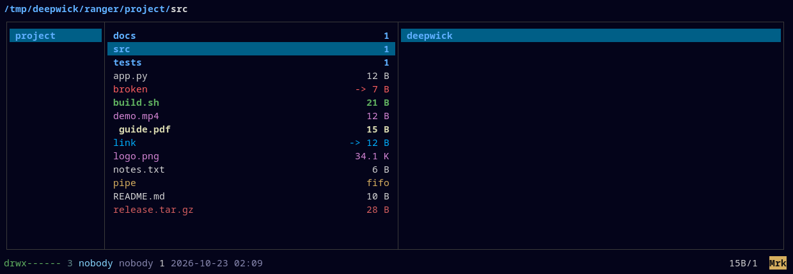

# Deepwick for ranger

Deepwick colors for the [ranger](https://ranger.fm) file manager.

> Deepwick is an unofficial theme derived from
> [Polywick Blue](https://vscode.polywickstudio.net) by Polywick Studio (MIT).
> Not affiliated with Polywick Studio.



## Install

```sh
mkdir -p ~/.config/ranger/colorschemes
cp deepwick.py ~/.config/ranger/colorschemes/
```

Then add this line to `~/.config/ranger/rc.conf`:

```
set colorscheme deepwick
```

A `rc.conf` holding only that line works: ranger loads its built-in
`rc.conf` first.

## Notes

- File colors follow the Deepwick file-listing roles, as in
  [eza](https://github.com/deepwick/eza) and
  [dircolors](https://github.com/deepwick/dircolors): directories bold Blue,
  executables bold Green, symlinks Cyan, broken symlinks Red, FIFOs, sockets
  and devices Gold, archives Rose, images, video and audio Magenta.
- Documents and source files are plain, unlike in eza and `ls`. ranger marks
  every text file (`.py` and `.sh` included) as a document, and a
  colorscheme never sees file names, so the two can't be told apart.
- The selected row sits on Selection; marked files are bold Yellow; cut and
  copied files are Muted; git status marks (`vcs_aware`) are Green for staged
  and clean, Blue for changed, Teal for untracked.
- ranger draws through curses, which has no 24-bit color, so these are the
  colors from [Deepwick's 256-color palette](https://github.com/deepwick/spec#256-color-palette).
  Backgrounds are left to the terminal, so a
  Deepwick terminal theme ([Konsole](https://github.com/deepwick/konsole),
  [Ptyxis](https://github.com/deepwick/ptyxis),
  [Alacritty](https://github.com/deepwick/alacritty),
  [Ghostty](https://github.com/deepwick/ghostty)) gives the exact background.
- ranger colors the permission string as a whole (Green when it's yours, Red
  otherwise), so the per-character permission colors of eza don't apply.
- Text previews come from ranger's `scope.sh` (highlight, pygmentize or bat),
  not from the colorscheme. Install [Deepwick for bat](https://github.com/deepwick/bat)
  for matching previews.
- ranger's pager isn't themed.
- The color block in `deepwick.py` is generated: run
  `PYTHONPATH=../spec python3 generate.py` with a
  [deepwick spec](https://github.com/deepwick/spec) checkout next to this repo.

Tested with ranger 1.9.4.

## License

MIT. See [LICENSE](LICENSE).
